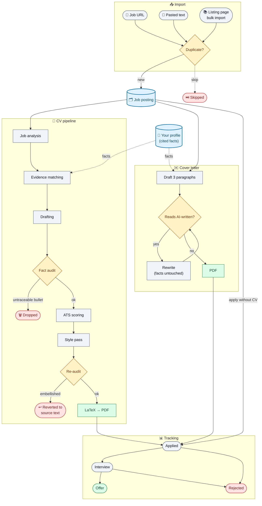

# CV Application Manager

A local-first, single-user application for tracking job applications and generating
per-posting, fact-checked CVs and cover letters through a real Claude + LaTeX
pipeline. Every claim in every generated document traces back to a real, cited fact
in your own profile — the pipeline is built to make things up *never*, not "rarely."

Full product spec: [`docs/spec/CV_APPLICATION_MANAGER_SPEC.md`](docs/spec/CV_APPLICATION_MANAGER_SPEC.md).
Architecture decisions: [`docs/adr/0001-tech-stack.md`](docs/adr/0001-tech-stack.md).
Pipeline internals, stage-by-stage: [`docs/pipeline_overview.md`](docs/pipeline_overview.md).

## What it does

- **Import job postings** — paste a URL (structured-data extraction where the board
  supports it, e.g. justjoin.it/NoFluffJobs), paste raw text, or **bulk-import an
  entire search-results page** (e.g. `justjoin.it/job-offers/remote/devops`) in one
  click. Safe to re-run any time — duplicates are detected and skipped, never
  silently re-created.
- **Generate a tailored CV** — a 7-stage pipeline (job analysis → evidence matching →
  drafting → fact audit → ATS scoring → style pass → re-audit → LaTeX/PDF render)
  where every bullet cites a real fact from your profile. An LLM-drafted bullet that
  can't be traced to a real fact id is dropped, not fixed — and if the model
  embellishes a real fact's wording, it's deterministically reverted to your own
  source text rather than "fixed" by asking the model to try again.
- **Generate a cover letter** — three short, specific paragraphs, plus an explicit
  self-check step that judges whether the draft *reads* AI-written and rewrites it if
  so (never touching a fact or number while doing it). Honestly bridges real
  technology gaps (e.g. you know GCP, the posting wants AWS) instead of overclaiming.
  Exports to PDF.
- **Track applications** — mark a posting as applied (with or without a CV generated
  through this app), move it through interview/offer/rejected, full status history.
- **See what it costs** — every LLM call is logged with tokens and estimated cost,
  rolled up per generation and on a usage dashboard broken down by stage/model/day.



See [`docs/pipeline_overview.md`](docs/pipeline_overview.md) for the full stage-by-stage
breakdown of both generation pipelines.

## Quick start (Docker, one command)

Requires only [Docker Desktop](https://www.docker.com/products/docker-desktop/) (or
Colima) running.

```bash
git clone <this-repo>
cd cv-application-manager
cp .env.example .env   # optional: add ANTHROPIC_API_KEY to enable real generation
docker compose up
```

Then open **http://localhost:5173**. The backend runs migrations, seeds an example
candidate profile on first boot, and compiles CVs/cover letters with a system LaTeX
install inside the container — nothing to install on the host. Both containers mount
the repo, so code edits on the host hot-reload inside them.

`./data` (SQLite DB, candidate profile, generated CVs/cover letters) is bind-mounted
to the host and persists across `docker compose up`/`down`. To wipe all app state and
start fresh:
```bash
docker compose down && rm -rf data/app.db data/jobs data/profile/versions
```

Without `ANTHROPIC_API_KEY` set, CV/cover-letter generation falls back to a
deterministic, no-cost mock pipeline — useful for trying the app end-to-end before
deciding to spend anything on real generations.

## Running without Docker

Useful for running the backend test suite directly, or if you'd rather not use
Docker at all.

### Prerequisites

- Python 3.12 (`brew install python@3.12`)
- Node.js 20+ (tested with Node 24)
- A LaTeX distribution providing `xelatex` with the `charter`/`fontspec` packages —
  BasicTeX is enough: `brew install --cask basictex` (interactive installer, needs
  your sudo password — run it yourself in a terminal, not from an automated tool).
  After installing:
  ```bash
  sudo tlmgr update --self
  sudo tlmgr install texlive-latex-recommended
  ```
- `poppler` for `pdftotext` / `pdfinfo` (`brew install poppler`)

### Backend setup

```bash
cd backend
python3.12 -m venv .venv
source .venv/bin/activate
pip install -e ".[dev]"
cp ../.env.example ../.env   # edit as needed, add ANTHROPIC_API_KEY for real generation
alembic upgrade head
python scripts/seed_profile.py   # imports fixtures/candidate.example.yaml as your active profile
uvicorn app.main:app --reload --port 8000
```

`scripts/seed_profile.py` imports the anonymous example profile so "Generate CV" has
something to work with immediately; it's idempotent (safe to re-run — skips if an
active profile already exists, pass `--force` to import a fresh version anyway).

To use your **real** profile: write it as YAML matching the schema in
`fixtures/candidate.example.yaml` (see spec section 9), or — if you already have a
richer, differently-shaped knowledge base — adapt
`backend/scripts/convert_legacy_profile.py` to convert it, then import via
`import_profile_version`. There is no profile-editing UI yet.

### Frontend setup

```bash
cd frontend
npm install
npm run dev
```

Frontend dev server proxies API calls to `http://127.0.0.1:8000` (override via the
`BACKEND_URL` env var — used by Docker Compose to point at the `backend` service).

## Configuration

All settings live in `.env` (repo root, git-ignored) — see
[`.env.example`](.env.example) for the full list with defaults. The one that matters
most: `ANTHROPIC_API_KEY`. Unset, every generation uses the deterministic mock
pipeline; set it, and the real 7-stage Claude pipeline runs. Per-stage model
overrides (`LLM_MODEL_ANALYSIS`, `LLM_MODEL_DRAFTING`, etc.) default to a
Haiku/Sonnet split chosen for cost — cheap models for extraction/scoring, stronger
ones for drafting/fact-auditing/style.

## Data directory

All persistent state (SQLite DB, candidate profile YAML + versions, per-job
generation artifacts: `.tex`, `.pdf`, structured CV/cover-letter JSON, compile logs)
lives under `./data`, which is git-ignored in full — nothing personal ever leaves
your machine. See layout in the spec, section 14.

## Running tests

```bash
cd backend
pytest
# or, with the stack running under Docker:
docker compose exec backend pytest
```

Tests never make real network calls or paid LLM calls: URL-import tests run against
saved HTML fixtures (`fixtures/html/`), and every LLM-calling pipeline stage is
tested against hand-built response objects or monkeypatched call boundaries — see the
module docstrings under `backend/tests/` for what each test file actually exercises.

## Non-goals for the MVP

No automatic application submission, no LinkedIn login/automation, no CAPTCHA
bypassing, no mass-applying. See spec section 2 ("Poza MVP") for the full list.
