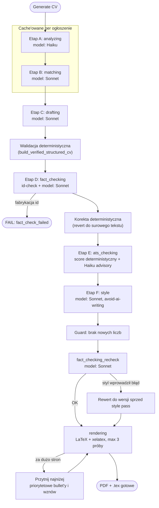
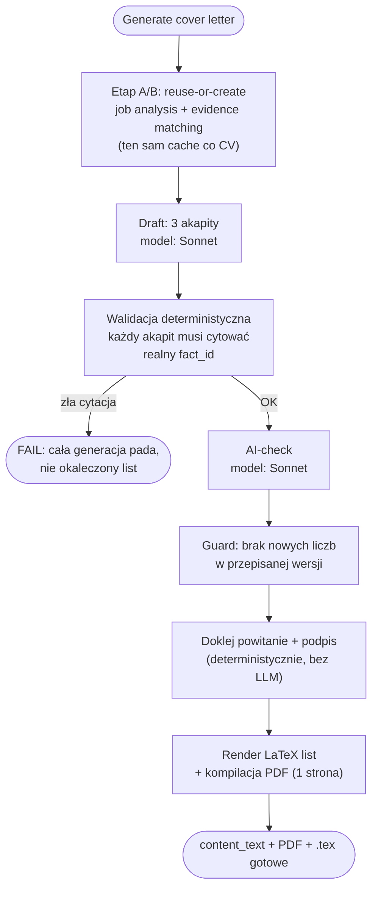
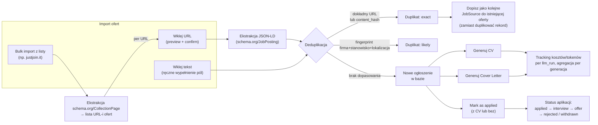

# Pipeline i funkcje aplikacji

Ten dokument opisuje co realnie dzieje się w kodzie: pipeline generowania CV, pipeline generowania cover letter, oraz pozostałe funkcje aplikacji (import ofert, deduplikacja, aplikowanie, koszty).

## 1. Pipeline generowania CV (`backend/app/services/cv_generation/pipeline.py`)

Uruchamiany po kliknięciu "Generate CV". Etapy A i B są cache'owane per ogłoszenie (kolejne generacje dla tej samej oferty ich nie płacą ponownie), etapy C-G biegną za każdym razem od nowa.

**Etap A — analyzing** (`analysis.py`, model: Haiku)
Ogłoszenie (opis + tytuł + firma) trafia do LLM, który zwraca ustrukturyzowaną analizę: `must_have`, `nice_to_have`, `responsibilities`, `ats_keywords`, `domain_signals`, `seniority_signals`, `screening_risks`. Treść ogłoszenia traktowana jest jako niezaufane dane (instrukcje w środku nie mogą zmieniać zachowania modelu). Wynik zapisywany jako `JobAnalysis` w bazie i cache'owany — kolejna generacja dla tego samego ogłoszenia go nie przelicza.

**Etap B — matching** (`evidence_matching.py`, model: Sonnet)
Dla każdego wymagania z Etapu A model przeszukuje pełny katalog faktów kandydata i zwraca: które realne `fact_id` je potwierdzają, typ dopasowania (`direct/partial/transferable/none`), pewność, oraz flagę `must_not_claim` gdy brak wystarczającego dowodu. Też cache'owane per ogłoszenie.

**Etap C — drafting** (`drafting.py`, model: Sonnet)
Pisze summary i bullet'y per stanowisko, **cytując realne `fact_id`** dla każdego zdania. Zasady: senior ton (zaczynaj od wyniku, nie od dziennika diagnostycznego), wplatanie keywordów ATS tylko gdy fakt to potwierdza (nigdy jako lista/upychanie), generalizacja nazw środowisk (nie "UAT1/UAT2", tylko "multiple environments"), priorytetyzacja bulletów (1 = najważniejszy, wyższe liczby = pierwsze do ucięcia). Model MUSI pokryć każde stanowisko z profilu przynajmniej jednym bulletem.
Zaraz po tym: **deterministyczna walidacja** (`build_verified_structured_cv`) — każdy bullet cytujący nieistniejący `fact_id` albo fakt z innego stanowiska jest **odrzucany w całości** (nie "naprawiany"). Jeśli model zostawił stanowisko bez bulletów, dokładany jest fallback: pierwszy fakt z profilu, verbatim.

**Etap D — fact_checking** (`fact_audit.py`, model: Sonnet)
Dwuwarstwowy audyt:
1. Deterministyczny, w Pythonie: czy każdy cytowany `fact_id` faktycznie istnieje w profilu (`run_fact_check`) — jeśli nie, **cała generacja pada** (`fact_check_failed`).
2. LLM-owy audyt semantyczny (`run_fact_audit`): porównuje treść bulleta z dosłownym brzmieniem cytowanego faktu, łapie podkręcanie liczb/zakresu/dat, awans PoC → produkcja, awans "znajomość" → "hands-on".
Jeśli audyt coś złapie: **żadnego retry-and-hope** — flagowany fragment jest deterministycznie **revertowany do surowego tekstu źródłowego z profilu** (nigdy nie prosimy modelu "spróbuj jeszcze raz").

**Etap E — ats_checking** (`ats_audit.py` + `ats_audit_llm.py`, deterministyczny score + Haiku advisory)
Wynik ATS liczony deterministycznie (pokrycie słów kluczowych oferty w CV) — to jest "score of record". LLM (Haiku) dorzuca tylko poradę: naturalność, dopasowanie tytułu, czy nie ma upychania keywordów — ale nie wpływa na sam wynik liczbowy.

**Etap F — style** (`style_pass.py`, model: Sonnet, zestaw reguł "avoid-ai-writing")
Przepisuje summary i bullet'y usuwając wzorce brzmiące jak AI: em dash jako łącznik zdań, "leverage/robust/seamless/cutting-edge", rule-of-three, puste wzmacniacze ("genuinely", "truly"), frazesy CV ("results-driven", "proven track record"). Twardy zakaz: żadna liczba/data/nazwa firmy/technologia nie może się zmienić — to styl, nie treść.
Deterministyczny guard po tym etapie: jeśli przepisany tekst zawiera liczbę, której nie było w oryginale, przepisanie jest **odrzucane** i zostaje wersja sprzed stylu.

**fact_checking_recheck** (ponownie `fact_audit.py`)
Po stylu audyt faktów uruchamiany jest **jeszcze raz** — jeśli styl przypadkiem wprowadził nadinterpretację, cała stylizowana wersja jest odrzucana na rzecz wersji sprzed Etapu F (nie próbujemy łatać punktowo).

**rendering** (`latex/render.py` + `latex/compiler.py`, xelatex)
Buduje kompletny `.tex` (własny szablon użytkownika, bez Jinja) i kompiluje do PDF. Jeśli PDF przekracza limit stron (`target_pages`), przycinane są bullet'y o najniższym priorytecie (proporcjonalnie do przekroczenia) i próba jest powtarzana — do `latex_max_repair_attempts` razy. Żadne stanowisko nigdy nie zostaje wyzerowane do 0 bulletów.

---

## 2. Pipeline generowania Cover Letter (`backend/app/services/cover_letter/generation.py`)

Uruchamiany synchronicznie (2 krótkie wywołania LLM, bez pętli kompilacji LaTeX jak przy CV) po kliknięciu "Generate cover letter". Reużywa Etap A/B z cache'u CV-generacji dla tego samego ogłoszenia, jeśli już istnieją.

**Etap A/B — reuse** (`_get_or_create_job_analysis` / `_get_or_create_evidence_matches`)
Zanim cokolwiek się napisze, funkcja sprawdza czy dla tego ogłoszenia istnieje już `JobAnalysis`/`EvidenceMatch` z generowania CV (albo wcześniejszego cover letter) — jeśli tak, używa ich zamiast płacić za ponowne wywołanie.

**Draft** (`cover_letter/drafting.py`, model: Sonnet)
Pisze dokładnie 3 akapity (~110-160 słów), każdy cytujący realne `fact_id`. Kluczowe zasady:
- **Voice**: kandydat jest luzacki, list ma brzmieć jak rozmowa ze znajomym inżynierem, nie raport — kontrakcje, lekki dowcip jeśli naturalnie wynika z faktu (nie na siłę).
- **Density**: jeden akapit = jedna myśl. Pokusa połączenia 3 osiągnięć przecinkami = sygnał, żeby wyciąć dwa, nie wydłużać zdanie.
- **Stack-gap bridging**: jeśli oferta chce technologii której kandydat nie ma, ale ma bliźniaczą (GCP↔AWS↔Azure, GKE↔EKS↔AKS) — nazywa wprost swoją prawdziwą technologię i uczciwie mówi że koncepcje się przekładają, nigdy nie podszywa się pod technologię z oferty.
- Zero "Dear Hiring Manager", zero "I look forward to hearing from you" — te frazesy są zakazane wprost.

**Walidacja deterministyczna** (`cover_letter/validation.py`)
W przeciwieństwie do bulletów CV, 3-akapitowego listu nie da się "naprawić" przez odrzucenie jednego akapitu — więc zła cytacja **wywala całą generację** (status `failed`), zamiast wysyłać okaleczony list.

**AI-check** (`cover_letter/ai_check.py`, model: Sonnet)
Osobne wywołanie, które **jawnie ocenia** (`sounds_ai_generated: bool` + uzasadnienie) czy tekst brzmi jak AI — sprawdza dwa tryby: oczywiste tell-e (leverage/robust/em dash) ORAZ subtelniejszy — tekst technicznie czysty, ale zimny, czytany na głos brzmi jak recytacja. Przepisuje tylko jeśli faktycznie złapie problem. Deterministyczny guard: przepisanie odrzucane, jeśli wprowadza liczbę której nie było w oryginale.

**Assemble + render**
Powitanie (`"Hi {firma} team,"`) i podpis (`"Best,\n{imię i nazwisko}"`) doklejane deterministycznie (nie przez LLM — to czysta forma). Całość renderowana do LaTeX (osobny, prosty szablon listu, ta sama typografia co CV) i kompilowana do jednostronicowego PDF.

---

## 3. Pozostałe funkcje aplikacji

**Import przez URL** (`ingestion/url_import.py`)
Dwuetapowy: `preview` pobiera stronę (SSRF-safe fetch, redirect re-walidowany na każdym hopie), próbuje wyciągnąć `schema.org/JobPosting` JSON-LD; jeśli go nie ma — fallback na ręczne wypełnienie pól z oczyszczonego tekstu strony. `confirm` faktycznie zapisuje rekord dopiero po akceptacji użytkownika (albo automatycznie w bulk-imporcie).

**Import przez wklejony tekst** (`ingestion/text_import.py`)
Użytkownik ręcznie podaje firmę/stanowisko/opis — bez ekstrakcji, ale przechodzi przez tę samą deduplikację.

**Bulk import z listy** (`ingestion/bulk_import.py`)
Dla stron typu `justjoin.it/job-offers/...?published-date=1`: czyta `schema.org/CollectionPage.hasPart[].url` (publiczne dane pod SEO, nie prywatne API), i dla **każdego** znalezionego URL-a przepuszcza go przez dokładnie ten sam `preview_url_import` + `confirm_url_import` co pojedynczy import. Brak structured data na stronie oferty = pominięcie (nie zapisujemy pustych pól bez człowieka do przejrzenia). Bezpieczne do wielokrotnego odpalania — już zaimportowane oferty są wykrywane i pomijane, nigdy nie duplikowane.

**Deduplikacja** (`deduplication/`)
Dwa poziomy: `exact` (identyczny `canonical_url` albo identyczny hash treści opisu) i `likely` (fingerprint z firmy+stanowiska+lokalizacji, gdy treść się różni ale to prawdopodobnie ta sama rekrutacja). Duplikat nigdy nie tworzy po cichu drugiego rekordu — albo zostaje dopisany jako dodatkowe `JobSource` do istniejącego, albo user świadomie wymusza osobny rekord.

**Mark as applied** (`applications/service.py`)
Można oznaczyć ofertę jako aplikowaną **z lub bez** wygenerowanego przez appkę CV (np. gdy zaaplikowano czymś swoim). Każda zmiana statusu (`applied/interview/offer/rejected/withdrawn`) zapisywana jest jako `ApplicationEvent` — historia się nie nadpisuje.

**Usage / koszty** (`cv_generation/cost.py`, `cv_generation/usage.py`)
Każde wywołanie LLM (każdy etap każdego pipeline'u) loguje się jako `LlmRun`: model, tokeny in/out, szacowany koszt, status, latencja. Koszty agregowane są per CV-generacja i per cover-letter, plus zbiorczy dashboard `/usage` (rozbicie per etap/model/dzień).
